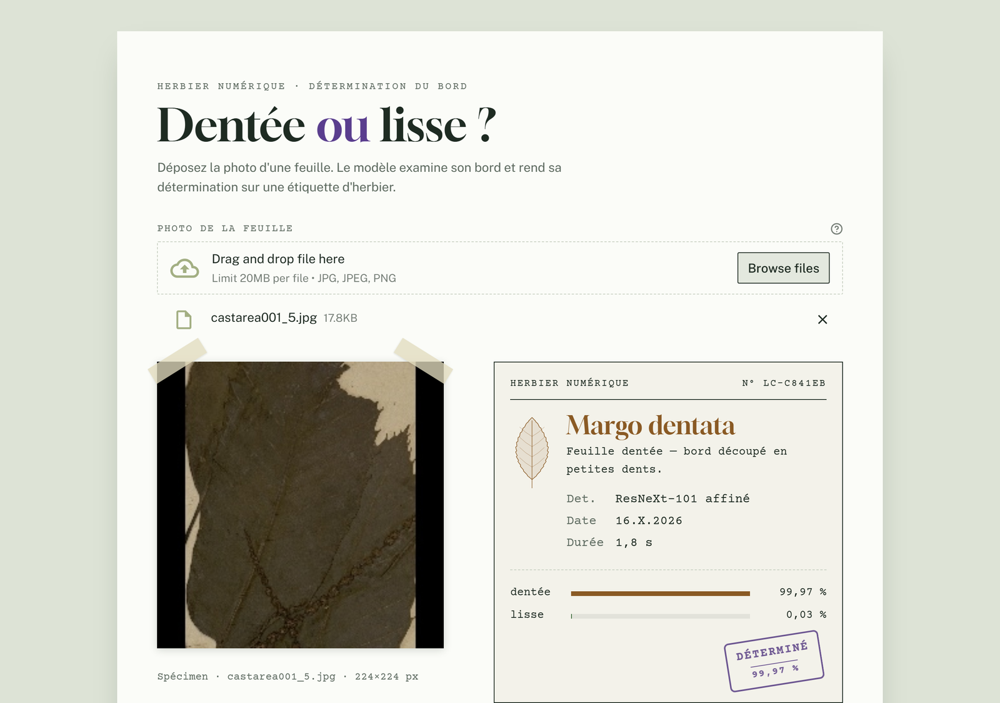
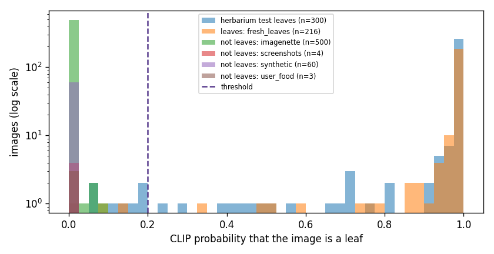

# 🍃 Leaf Classification

[](https://github.com/dihiaganoun/Leaf-Classification/actions/workflows/ci.yml)


[](https://leaf-margin-classifier.streamlit.app)
[](https://huggingface.co/dganoun/leaf-classifier-resnext101)

Classifies a leaf photo by the shape of its margin: **dentée** (toothed edge) or **lisse** (smooth edge).

A **ResNeXt-101 (32×8d)** pretrained on ImageNet is fine-tuned on ~6,500 leaf images, then served through a **Streamlit** web app.

**▶ [Try the live demo](https://leaf-margin-classifier.streamlit.app)**, no installation needed.



## Results

Evaluated on the held-out **test split** (15% of the dataset, 984 images, never seen during training):

| Metric | Score |
|--------|-------|
| Accuracy | **98.68%** |
| F1 | 0.9861 |
| Precision | 0.9935 |
| Recall | 0.9787 |
| Balanced accuracy | 0.9864 |
| Cohen's kappa | 0.9735 |

| Class | Precision | Recall | F1 | Images |
|-------|-----------|--------|----|--------|
| dente | 0.99 | 0.98 | 0.99 | 470 |
| lisse | 0.98 | 0.99 | 0.99 | 514 |

These numbers come from `notebooks/training.ipynb` (Colab, GPU).

### Local check of the published weights

`scripts/evaluate.py` re-runs the published weights on a stratified sample of the test split (150 images per class, CPU):

| Sample | Accuracy | Macro F1 | Errors |
|--------|----------|----------|--------|
| 300 images | 99.67% | 0.9967 | 1 (a toothed leaf predicted smooth) |


The `dente` sample is exactly from the held-out test split. The local copy of the dataset has 15 fewer `lisse` images than the one used for training, so the `lisse` split cannot be rebuilt identically and that half of the sample may include training images. Treat this table as a check that the weights work, and the test-split table above as the real score.

## Rejecting images that are not leaves

A two-class classifier always picks a class: a screenshot was labelled "dentée" with 93% confidence. The app now checks the image before trusting the answer, in three steps:

1. **Blank image.** Nearly uniform images (pixel standard deviation under 5) are refused. The least contrasted leaf in the dataset is at 19.2.
2. **Is it a leaf? (CLIP, decides).** A zero-shot [CLIP](https://github.com/mlfoundations/open_clip) model (ViT-B-32, LAION-2B) compares the image with text descriptions: 5 for leaves (fresh or pressed) and 17 for other things (food, berries, animals, screenshots, flowers, whole trees…). The image is refused when less than 20% of the probability goes to the leaf descriptions. CLIP judges what the image shows, not its style, so it accepts fresh leaf photos too.
3. **Does it look like the training data? (Mahalanobis, informs).** The classifier was trained only on herbarium scans. The [Mahalanobis distance](https://arxiv.org/abs/1807.03888) of its 2048-d features to the training leaves (`scripts/fit_leaf_detector.py`) tells whether a photo is in that domain. Leaves outside it are still classified, but stamped *Indicatif* with a note, because the classifier was never measured on such photos.

**Results.** The 0.2 threshold was chosen on development data only (herbarium validation split and 500 Imagenette photos), then measured on separate data (`scripts/calibrate_leaf_gate.py`):

| Images | Count | Result |
|--------|-------|--------|
| Herbarium test leaves | 300 | **97.3% accepted** |
| Fresh leaf photos, 15 species ([Indian leaves](https://huggingface.co/datasets/avaishnav/Indian-plant-leaves-species), [medicinal leaves](https://huggingface.co/datasets/poojan-s/medicinal-leaf-classification-dataset)) | 216 | **98.6% accepted** |
| [Imagenette](https://github.com/fastai/imagenette) photos (dogs, trucks, churches…) | 500 | **100% rejected** |
| Food on white backgrounds (berries, macarons, cake) | 3 | 100% rejected |
| Screenshots and diagrams | 4 | 100% rejected |
| Synthetic images (solid colours, gradients, noise) | 60 | 100% rejected |



Refused leaves are mostly tiny fragments, curled or very dark specimens. An earlier attempt to crop the black padding of dataset images before CLIP made acceptance worse on validation data and was dropped.

**Why not the Mahalanobis detector alone?** It was the first version: it rejected 98.6% of Imagenette photos while accepting 99.2% of herbarium test leaves ([details](docs/leaf_detector.json)), but it learned the *look* of herbarium scans rather than what a leaf is. It refused real photos of fresh leaves and accepted blueberries on a white background (closer to the beige herbarium paper than a green leaf photo).

**Cost.** CLIP adds about 580 MB of weights (downloaded once from Hugging Face, the text part is freed after start-up) and about 0.25 s per image on CPU. The Mahalanobis statistics (`ood_stats.npz`, 16 MB) are hosted next to the classifier weights.

## Project structure

```
Leaf-Classification/
├── app/
│   └── streamlit_app.py      # Web interface
├── src/leaf_classifier/
│   ├── config.py             # Classes, image size, model path
│   ├── model.py              # Model building, weight loading, inference
│   ├── leaf_gate.py          # CLIP check: is the image a leaf?
│   ├── ood.py                # Analysis + Mahalanobis "looks like the training data"
│   └── data.py               # Train/val/test split (same as the notebook)
├── scripts/
│   ├── evaluate.py           # Evaluation on a test sample
│   ├── fit_leaf_detector.py  # Fits the Mahalanobis detector
│   └── calibrate_leaf_gate.py # Measures the CLIP check
├── tests/                    # Unit tests (no weights needed)
├── notebooks/
│   └── training.ipynb        # Training and full test evaluation
├── docs/                     # Screenshot, metrics, confusion matrix
├── Dockerfile
├── requirements.txt          # Pinned runtime dependencies
└── requirements-dev.txt      # + evaluation and test tools
```

## Getting started

### 1. Clone

```bash
git clone https://github.com/dihiaganoun/Leaf-Classification.git
cd Leaf-Classification
```

The trained weights (~350 MB) are hosted on [Hugging Face Hub](https://huggingface.co/dganoun/leaf-classifier-resnext101). They are downloaded automatically the first time the model is loaded, then cached.

### 2. Install

```bash
python -m venv .venv
source .venv/bin/activate        # Windows: .venv\Scripts\activate
pip install -r requirements.txt
```

`requirements.txt` also installs the `leaf_classifier` package in editable mode.

### 3. Run the app

```bash
streamlit run app/streamlit_app.py
```

Then open http://localhost:8501.

To use a local copy of the weights instead, put it in `models/resnext101_leaves.pth` or set `LEAF_MODEL_PATH=/path/to/weights.pth`.

### Docker

```bash
docker build -t leaf-classifier .
docker run -p 8501:8501 leaf-classifier
```

The image uses CPU-only PyTorch to stay small and downloads the weights at build time. The live demo runs on Streamlit Community Cloud, which uses `app/requirements.txt` (CPU-only PyTorch).

## Using the model in Python

```python
from PIL import Image
from leaf_classifier import load_model, predict

model = load_model()
print(predict(model, Image.open("leaf.jpg")))
# e.g. {'dente': 0.0003, 'lisse': 0.9997}

# With the checks used by the app
from leaf_classifier.leaf_gate import ClipLeafGate
from leaf_classifier.ood import LeafDetector, analyze

result = analyze(model, LeafDetector.load(), Image.open("photo.jpg"), ClipLeafGate.load())
print(result.is_leaf, result.rejection, result.in_domain, result.probs)
# e.g. False 'not_leaf' ...  -> do not trust probs
#      True  None  False ... -> a leaf, but unlike the training scans: indicative
```

## Development

```bash
pip install -r requirements-dev.txt
pytest                                   # fast, uses a stub model
python scripts/evaluate.py --data-dir path/to/feuilles_plantes --per-class 150
python scripts/fit_leaf_detector.py --data-dir path/to/feuilles_plantes \
    --ood-dir path/to/imagenette/val --ood-dir path/to/other_non_leaf_images
```

The dataset is not versioned. `--data-dir` must contain one folder per class (`dente/`, `lisse/`).

GitHub Actions runs the tests on every push and pull request.

## Model and training

- **Backbone:** ResNeXt-101 32×8d, ImageNet weights
- **Fine-tuning:** `layer3`, `layer4` and the new `fc` head are trained, earlier layers are frozen
- **Split:** stratified 70% train / 15% validation / 15% test (seed 0)
- **Optimizer:** AdamW, lr 1e-4, `ReduceLROnPlateau` on validation loss
- **Training:** 20 epochs, batch size 32, input 224×224, ImageNet normalization

## Known limitations

Found while reviewing the training notebook. They do not affect the published results above, which were measured on the saved weights, but they matter for retraining:

- **Data augmentation is not applied.** The train and test subsets share one dataset object, and its transform is switched to the evaluation transform right after the train loader is built. Training therefore ran without augmentation.
- **"Best model" is actually the last epoch.** `model.state_dict().copy()` is a shallow copy, so the saved "best" state keeps changing with training. The saved weights are from epoch 20.
- **The AUC printed in the notebook (0.0009) is inverted.** The score used is the `lisse` probability while the positive class is `dente`. The real AUC is about 0.999.
- The classifier's accuracy on fresh leaf photos has not been measured (the fresh photos above have no margin labels). The app accepts them but stamps the result *Indicatif*.
- The CLIP check was measured on everyday photos, a few food images, screenshots and synthetic images. Other plant photos (flowers, whole plants, several leaves at once) were not measured separately; the "whole tree" and "flower" descriptions are there to catch them.
- Some herbarium leaves (2.7% of the test sample: fragments, curled or very dark specimens) are refused as "not a leaf".

## License

[MIT](LICENSE)
